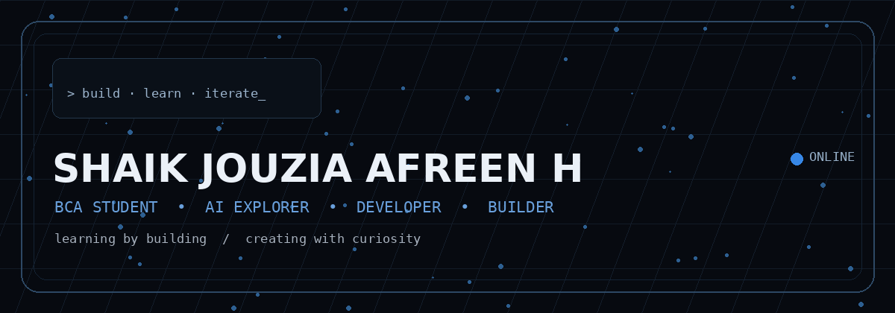

<!-- SHAIK JOUZIA AFREEN H -->

<p align="center">
  
</p>

<h1 align="center">Shaik Jouzia Afreen H</h1>

<p align="center"><strong>BCA Student · Applied AI Research · Software Engineering</strong></p>

<p align="center">I investigate how AI systems behave, build software around practical problems, and document what the evidence actually supports.</p>

<p align="center">
  <a href="https://github.com/jouzia">GitHub</a> ·
  <a href="https://www.linkedin.com/in/jouzia-afreen-h/">LinkedIn</a> ·
  <a href="https://portfolio-sjha.vercel.app/">Portfolio</a>
</p>

---

## About

I'm **Shaik Jouzia Afreen H**, a BCA student at **St. Joseph's College of Arts & Science (Autonomous), India**.

My GitHub work is organized into two tracks:

- **Research:** empirical studies of retrieval-augmented generation (RAG), LLM routing and transfer, and the water impact of AI infrastructure.
- **Engineering projects:** AI applications, agent-based experiences, developer tools, and backend systems.

I value reproducible experiments, clear limitations, and honest reporting. Ongoing work is labelled as ongoing; preliminary findings are not presented as established results.

---

# Research

These repositories document independent research projects. They are not presented as peer-reviewed publications.

## 1. RAG Appended-Context Study

**[Effects of Appended Distractor Context on RAG Answer Quality and Generation Latency](https://github.com/jouzia/rag-retrieval-robustness-benchmark)**

Studies how adding distractor chunks to retrieved context affects answer-quality measures and generation-call latency across BM25, dense, and hybrid retrieval pipelines.

- **Research focus:** retrieval-augmented generation, distractor context, answer quality, latency.
- **Approach:** controlled evaluation across retrieval approaches and distractor conditions.
- **Status:** exploratory empirical study; conclusions are limited to the tested benchmark, implementation, top-k setting, and noise conditions.
- **Important scope note:** this is an appended-context evaluation, not a universal claim about retrieval-ranking robustness.

## 2. AI Waste Heat to Water

**[From AI Waste Heat to Water: A Net-Water-Impact Framework for Sustainable AI Infrastructure](https://github.com/jouzia/ai-waste-heat-water)**

Develops a framework for assessing when AI infrastructure waste heat might support thermal desalination while accounting for cooling, energy, and water burdens.

- **Research focus:** AI infrastructure sustainability, thermal desalination, net freshwater impact, sensitivity and uncertainty analysis.
- **Approach:** transparent system boundaries and water/energy accounting that distinguish gross freshwater production from net impact.
- **Status:** ongoing modeling and research framework.
- **Important scope note:** modeled and illustrative outputs are not proof of real-world water savings.

## 3. LLM Router Transfer Study

**[Evaluating Cross-Benchmark Transfer of a Lightweight LLM Router](https://github.com/jouzia/llm-router-transfer-study)**

Investigates whether a lightweight prompt-feature router generalizes across benchmark families and how its results compare with fixed-model baselines.

- **Research focus:** LLM routing, cross-benchmark transfer, baseline selection, evaluation reliability.
- **Approach:** empirical comparison of a lightweight router and fixed-model baselines, including held-out benchmark evaluation.
- **Status:** experimental results available; broader generalization and algorithmic novelty are not established.
- **Important scope note:** current evidence does not establish consistent superiority over the global baseline.

---

# Engineering Projects

These projects focus on implementing AI applications, developer tools, and software systems. Their maturity and runtime verification vary by repository; see each project's README for its current status.

## AI Applications and Agent Systems

### [Bud AI](https://github.com/jouzia/Bud-AI)
A multi-agent educational AI platform exploring agent routing, stateful study environments, conversational memory, and reward-driven evaluation, with a Next.js interface and Python components.

### [Chat-AI](https://github.com/jouzia/Chat-AI)
A conversational learning assistant experiment using Streamlit, LangChain, Gemini/Groq models, and ChromaDB, with mentor and rival-style AI personas.

### [OpenEnv-Core](https://github.com/jouzia/OpenEnv-Core)
An interactive study dashboard concept with a logic-learning workspace, AI companion, provisional CGPA projections, and an animated interface.

### [MCP — Web Perception and Browser Automation](https://github.com/jouzia/MCP)
An MCP-oriented web perception and browser automation project exploring Next.js, TypeScript, Python, Notte, and Patchright.

## Developer Tools and Backend Systems

### [Tracker-AI](https://github.com/jouzia/Tracker-AI)
A pre-implementation concept for a developer portal combining project tracking, grounded debugging assistance, and deployment telemetry. The public repository currently contains the concept README only; no working application or tests are claimed.

### [Pulse-AI](https://github.com/jouzia/Pulse-AI)
An event-driven notification infrastructure project using FastAPI, PostgreSQL, Redis, and Celery, with asynchronous delivery, retries, rate limiting, and observability planned in the implementation. Check the repository's testing notes for runtime-verification status.

## Web Development

### [Portfolio](https://github.com/jouzia/Portfolio)
A portfolio website built with React, Vite, Tailwind CSS, Framer Motion, and Supabase, with authentication and content-management features.

### [buddy-lab-demo](https://github.com/jouzia/buddy-lab-demo)
A Next.js experiment focused on component-based web development and modern UI implementation.

---

## Research Interests

- Retrieval-augmented generation and information retrieval
- Robustness to distractor context and retrieval defects
- LLM routing, model selection, and cross-benchmark transfer
- Evaluation design, baselines, uncertainty, and reproducibility
- Efficient AI systems and inference cost
- Sustainability and net-water impact of AI infrastructure

## Technical Toolkit

**Languages:** Python · JavaScript · TypeScript · Java · HTML · CSS

**Frontend:** React · Next.js · Vite · Tailwind CSS · Framer Motion

**AI and data:** LLM APIs · Gemini · Groq/Llama · LangChain · AI agents · ChromaDB · Streamlit

**Backend and infrastructure:** FastAPI · PostgreSQL · Supabase · Redis · Celery · Vercel

**Tools:** Git · GitHub · GitHub Actions · VS Code · Linux

*Technologies listed reflect project work and ongoing learning; proficiency and runtime verification vary by project.*

---

## Achievements

- **1st Place — PPT Presentation:** won first place in a presentation competition; no certificate was issued.
- **3rd Place — Start-up Business Plan Competition:** intra-departmental competition at St. Joseph's College, **2 August 2024**.
- **QuizOff 2026 — India's Biggest AI Quiz:** recognition/participation associated with CampusCrew and Unstop, **19 July 2026**.

## Certifications

- **IBM SkillsBuild** — *Classifying Data Using IBM Granite*
- **HubSpot Academy** — *Social Media Certified*; valid **23 May 2026 – 21 June 2028**
- **CampusCrew × Unstop** — *QuizOff 2026: India's Biggest AI Quiz*; recognition/participation certificate, **19 July 2026**

## Education

**Bachelor of Computer Applications (BCA)**  
St. Joseph's College of Arts & Science (Autonomous), India

---

## GitHub Activity

<p align="center">
  
</p>

<p align="center">
  
</p>

## Contributions

<p align="center">
  <picture>
    <source media="(prefers-color-scheme: dark)" srcset="https://raw.githubusercontent.com/jouzia/jouzia/output/github-snake-dark.svg">
    <source media="(prefers-color-scheme: light)" srcset="https://raw.githubusercontent.com/jouzia/jouzia/output/github-snake.svg">
    
  </picture>
</p>

---

## How I Work

```text
Question → Hypothesis → Experiment → Measure → Audit → Improve
                         ↘ Build → Test → Document
```

I want my profile to show both sides of my work: **research questions tested carefully** and **software projects built iteratively**. I aim to make the evidence, limitations, and current status clear enough for collaborators, researchers, and recruiters to evaluate.

---

## Connect

<p align="center">
  <a href="https://github.com/jouzia">GitHub</a> ·
  <a href="https://www.linkedin.com/in/jouzia-afreen-h/">LinkedIn</a> ·
  <a href="https://portfolio-sjha.vercel.app/">Portfolio</a>
</p>

<p align="center"><strong>Open to internships, research conversations, collaborations, and applied AI engineering opportunities.</strong></p>

<p align="center"><sub>Built with curiosity · evaluated with care · improved through iteration.</sub></p>
